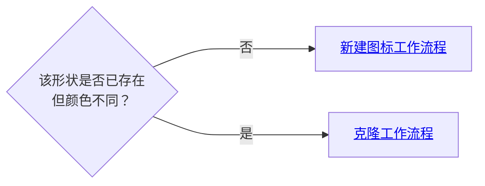
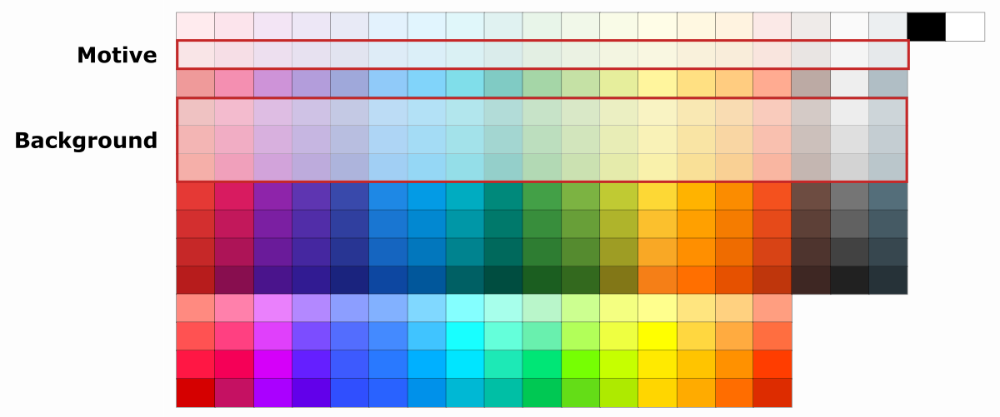
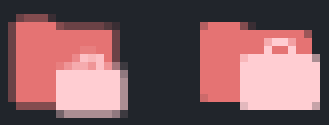
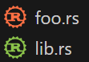

# 如何参与贡献

很高兴你能来到这里，并对扩展这个项目感兴趣 🎉 为了让协作尽可能顺畅，本页为希望成功贡献的参与者准备了一些提示与建议。请仔细阅读全部内容，你的贡献将会很有价值，也会被欣然接受。

<!-- TOC -->

- [如何参与贡献](#如何参与贡献)
  - [图标需求](#图标需求)
  - [添加新图标](#添加新图标)
  - [约定式 Pull Request 标题](#约定式-pull-request-标题)
  - [新建图标工作流程](#新建图标工作流程)
    - [检查清单](#检查清单)
    - [克隆工作流程](#克隆工作流程)
      - [检查清单](#检查清单-1)
  - [操作指南](#操作指南)
    - [以 SVG 创建图标](#以-svg-创建图标)
    - [已知图标来源](#已知图标来源)
    - [使用 Material Design 配色](#使用-material-design-配色)
    - [应用图标渐变](#应用图标渐变)
    - [设计文件夹图标](#设计文件夹图标)
    - [图标留白](#图标留白)
    - [关联到文件名、文件夹名与语言 ID](#关联到文件名文件夹名与语言-id)
      - [文件图标](#文件图标)
      - [应用模式](#应用模式)
      - [文件夹图标](#文件夹图标)
      - [根文件夹图标](#根文件夹图标)
      - [语言图标](#语言图标)
      - [适配配色主题的图标](#适配配色主题的图标)
    - [创建图标包](#创建图标包)
    - [设计像素级精准图标](#设计像素级精准图标)
      - [像素级精准图标设计技巧](#像素级精准图标设计技巧)
    - [克隆现有图标](#克隆现有图标)
      - [防止克隆图标被重新着色](#防止克隆图标被重新着色)
  - [添加翻译](#添加翻译)
  - [本地调试扩展](#本地调试扩展)
    - [启用日志](#启用日志)

<!-- /TOC -->

## 图标需求

需要为某个文件名、文件扩展名或文件夹名称新增图标？请创建 Issue 并遵循以下规则：

- 说明需要的是文件图标还是文件夹图标，或两者都需要
- 列出相关的文件名／文件扩展名和文件夹名称
- 提出一些图形设计构想（图标可以长什么样）
- 展示该图标的示例图片，或提供相关网站的链接

## 添加新图标

我们随时欢迎为扩展添加新图标。不过，为了让图标能够顺利被纳入扩展，有几件事需要你留意。



## 约定式 Pull Request 标题

你的 Pull Request 标题应遵循[约定式提交格式](https://www.conventionalcommits.org/en/v1.0.0/)。当 Pull Request 被合并到主分支时，所有改动会被压缩成单个提交。该提交的信息就是 Pull Request 的标题。每次发布时，这些提交信息会被用来生成更新日志。

以下是一些约定式 PR 标题的示例：

- `feat: add new icons for Rust`
- `fix: correct icon for .gitignore`
- `ci: add GitHub Actions for automated testing`

基于提交信息生成更新日志既能节省时间，也有助于让更新日志保持最新，同时还能帮助理解项目中的改动。

## 新建图标工作流程

### 检查清单

1. [ ] 以 SVG 创建图标（[操作方法](#以-svg-创建图标)）
2. [ ] 图标颜色符合 Material Design 规范（[操作方法](#使用-material-design-配色)）
3. [ ] 图标应用了同色系渐变（[操作方法](#应用图标渐变)）
4. [ ] SVG 在图标周围留有一定空间（[操作方法](#图标留白)）
5. [ ] 唯一地关联到文件名与文件夹名称（[操作方法](#关联到文件名文件夹名与语言-id)）
6. [ ] 如有必要，为不同配色主题分别提供图标（[操作方法](#适配配色主题的图标)）

### 克隆工作流程

有时候我们只需要为现有图标创建一个变体。

例如，我们可能想用 `typescript` 图标的形状，但希望它是绿色的，并关联到 `library.ts` 这个文件名。这种情况下，我们不需要新建一个 SVG，通过配置即可完成。

#### 检查清单

1. [ ] 克隆现有图标并调整其颜色（[操作方法](#克隆现有图标)）

## 操作指南

### 以 SVG 创建图标

推荐使用以下免费工具来创建或编辑新的 SVG 图标：

- [Inkscape](https://inkscape.org/en/) 是一款免费的开源 SVG 编辑器
- 也有一些工具可以把 PNG/JPG 图片转换为 SVG——例如 [Autotracer.org](https://autotracer.org) 和 [Vectorizer.io](https://vectorizer.io)。

> [!NOTE]
> 务必产出完全_矢量化_的图形（不要在 SVG 中内嵌 base64 图片字符串）。

创建文件夹图标时，你只需要提供**关闭**状态的那一个版本。打开状态会在构建时自动生成。

```text
📁 folder-example.svg
```

文件夹 SVG 必须遵循以下确切结构：

```svg
<svg xmlns="http://www.w3.org/2000/svg" viewBox="0 0 16 16">
  <defs>
    <linearGradient id="folderGradient" x1="0%" y1="0%" x2="100%" y2="100%">
      <stop offset="0%" stop-color="#COLOR_HIGHLIGHT"/>
      <stop offset="50%" stop-color="#COLOR"/>
      <stop offset="100%" stop-color="#COLOR_SHADOW"/>
    </linearGradient>
    <linearGradient id="motiveGradient" x1="0%" y1="0%" x2="100%" y2="100%">
      <stop offset="0%" stop-color="#MOTIVE_HIGHLIGHT"/>
      <stop offset="50%" stop-color="#MOTIVE_COLOR"/>
      <stop offset="100%" stop-color="#MOTIVE_SHADOW"/>
    </linearGradient>
  </defs>
  <path id="folder" fill="url(#folderGradient)" d="m6.922 3.768-.644-.536A1 1 0 0 0 5.638 3H2a1 1 0 0 0-1 1v8a1 1 0 0 0 1 1h12a1 1 0 0 0 1-1V5a1 1 0 0 0-1-1H7.562a1 1 0 0 1-.64-.232"/>
  <path id="motive" fill="url(#motiveGradient)" d="...your motive path..."/>
</svg>
```

要求：

- **viewBox** 必须为 `0 0 16 16`
- **第一个元素**必须是带 `id="folder"` 的 `<path>`，并使用上文给出的标准文件夹路径（只有 `fill` 渐变引用可变，路径 `d` 不得修改）
- **图形元素**必须带 `id="motive"`——可以是单个 `<path>`，也可以是包裹多个路径的 `<g>`
- **使用渐变填充**——`fill` 通过 `url(#渐变ID)` 引用 `<defs>` 中定义的渐变，具体规则见[应用图标渐变](#应用图标渐变)
- **不要提供 `-open.svg` 文件**——不要提交打开状态的变体，它们会自动生成
- **不要包含 Inkscape/Sodipodi 元数据**——提交前请清理 SVG

如果你的图形元素需要多个路径或元素，请将它们包裹在一个分组中：

```svg
<svg xmlns="http://www.w3.org/2000/svg" viewBox="0 0 16 16">
  <defs>
    <linearGradient id="folderGradient" x1="0%" y1="0%" x2="100%" y2="100%">
      <stop offset="0%" stop-color="#COLOR_HIGHLIGHT"/>
      <stop offset="50%" stop-color="#COLOR"/>
      <stop offset="100%" stop-color="#COLOR_SHADOW"/>
    </linearGradient>
    <linearGradient id="motiveGradient" x1="0%" y1="0%" x2="100%" y2="100%">
      <stop offset="0%" stop-color="#MOTIVE_HIGHLIGHT"/>
      <stop offset="50%" stop-color="#MOTIVE_COLOR"/>
      <stop offset="100%" stop-color="#MOTIVE_SHADOW"/>
    </linearGradient>
    <linearGradient id="motiveGradient2" x1="0%" y1="0%" x2="100%" y2="100%">
      <stop offset="0%" stop-color="#ANOTHER_HIGHLIGHT"/>
      <stop offset="50%" stop-color="#ANOTHER_COLOR"/>
      <stop offset="100%" stop-color="#ANOTHER_SHADOW"/>
    </linearGradient>
  </defs>
  <path id="folder" fill="url(#folderGradient)" d="m6.922 3.768-.644-.536A1 1 0 0 0 5.638 3H2a1 1 0 0 0-1 1v8a1 1 0 0 0 1 1h12a1 1 0 0 0 1-1V5a1 1 0 0 0-1-1H7.562a1 1 0 0 1-.64-.232"/>
  <g id="motive">
    <path fill="url(#motiveGradient)" d="..."/>
    <path fill="url(#motiveGradient2)" d="..."/>
  </g>
</svg>
```

> [!NOTE]
> 每次提交 PR 时，CI 检查都会校验所有文件夹图标的结构。提交前可在本地运行 `npm run check` 验证你的图标是否通过。

当然，你也可以直接添加已有的 SVG。不过大多数情况下仍需调整颜色或修改样式，以满足上述检查清单中的其他要求。

### 已知图标来源

- [Material Design Icons](https://pictogrammers.com/library/mdi/)
- [Material Symbols](https://fonts.google.com/icons)

### 使用 Material Design 配色

这个图标扩展之所以成功，一个重要因素是所有颜色都能和谐搭配。这是因为所有图标只使用 [Material Design 调色板](https://material.io/design/color/the-color-system.html#tools-for-picking-colors)中的颜色。这样可以形成良好的对比，图标也很容易辨识。

不过，许多编程语言本身已经有带专属颜色的图标。如果想基于已知颜色在 Material Design 调色板中找到匹配的颜色，可以使用 [Material Color Converter](https://aurorp1g.github.io/material-color-converter/)。借助它，任何颜色都可以转换为 Material Design 颜色。

> [!NOTE]
> 图标中不允许使用黑色（`#000000`）和白色（`#ffffff`）。这两种颜色对比度过高，与图标的整体观感不协调。

请继续阅读[设计文件夹图标](#设计文件夹图标)一节，了解文件夹图标的配色要求。

| ✅ | ❌ |
| :-: | :-: |
|  |  |

### 应用图标渐变

本项目所有图标都使用统一的渐变样式，模拟左上角光源的打光效果：**左上角最亮，右下角最深**。请遵循以下规则：

1. **路径完全不动，仅修改填充**：所有 `<path>` 的 `d` 属性必须原样保留，禁止改动坐标，只把 `fill` 值替换为渐变引用 `url(#渐变ID)`。
2. **以原图底色为色相根基**：读取每个 path 的原始 `fill` 色值作为基准色，在**同一色相**内做提亮与加深，禁止跳到完全无关的色系。
   - 左上角 `offset="0%"`：同色相提亮（高光）；
   - 中间 `offset="50%"`：保留原图基准色；
   - 右下角 `offset="100%"`：同色相加深（暗部，允许轻微邻近色偏移）。
3. **固定渐变方向**：`x1="0%" y1="0%" x2="100%" y2="100%"`，保证左上亮、右下暗。
4. **分层独立处理**：多层多 path 图标，每一层都基于自身原始底色生成独立渐变，并分配唯一渐变 ID。主体图形可设置适中明暗差；**细小装饰／徽章元素必须压低明暗反差**，防止 16px 下细节糊掉。
5. **渐变统一收纳在 defs**：所有 `<linearGradient>` 写在 `<defs>` 内，放在所有 path 标签之前。

通用模板：

```svg
<svg viewBox="0 0 16 16" xmlns="http://www.w3.org/2000/svg">
  <defs>
    <linearGradient id="GradId" x1="0%" y1="0%" x2="100%" y2="100%">
      <stop offset="0%" stop-color="【同色相提亮高光】"/>
      <stop offset="50%" stop-color="【原图基准色】"/>
      <stop offset="100%" stop-color="【同色相加深暗部】"/>
    </linearGradient>
  </defs>
  <!-- d 原样复制，仅 fill 引用渐变 ID -->
  <path d="原始 d 字符串" fill="url(#GradId)"/>
</svg>
```

> [!WARNING]
> 请务必避免以下做法：
> - ❌ 修改 path 的 `d` 路径字符串，改动图标轮廓坐标
> - ❌ 脱离原图底色，直接选用完全无关色系做渐变
> - ❌ 16px 小图标高光过度接近纯白、暗部颜色过重，造成轮廓糊掉
> - ❌ 多层 path 共用同一个渐变 ID
> - ❌ 将 `linearGradient` 放到 `defs` 之外，或写在 path 标签之后

### 设计文件夹图标

设计文件夹图标时也有几点需要考虑。文件夹图标始终由两部分组成——背景中的文件夹形状，以及前景中的图形元素：


文件夹形状（`id="folder"`）使用标准路径，不得修改——只能更改它的 `fill` 渐变引用。图形元素（`id="motive"`）才是你图标中富有辨识度的部分。

图形元素只允许使用[调色板](https://aurorp1g.github.io/material-color-converter/)中第二行的颜色。背景则选择稍深一些的色相（通常是调色板的第 4-6 行）。选定的颜色作为渐变基准色，再按[应用图标渐变](#应用图标渐变)一节生成左上高光 → 右下暗部的同色系渐变。



这种统一的配色选择让文件夹图标看起来更一致、彼此更协调，从而确保图标具备良好的品质。

| ✅ | ❌ |
| :-: | :-: |
|  |  |

### 图标留白

所有图标与边缘之间都留有少许间距。这样它们看起来不会过于拥挤，也更有呼吸感。具体需要留多少边距并没有硬性规定，因为这总是因人而异。只需确保图标外围留有空白即可。

| ✅ | ❌ |
| :-: | :-: |
|  |  |

### 关联到文件名、文件夹名与语言 ID

图标通过以下文件关联到文件名、文件夹名称或 VS Code 已注册的语言：

- [fileIcons.ts](https://github.com/aurorp1g/vscode-aurora-icon-theme/blob/main/src/core/icons/fileIcons.ts)
- [folderIcons.ts](https://github.com/aurorp1g/vscode-aurora-icon-theme/blob/main/src/core/icons/folderIcons.ts)
- [languageIcons.ts](https://github.com/aurorp1g/vscode-aurora-icon-theme/blob/main/src/core/icons/languageIcons.ts)

为文件和文件夹分配图标时要谨慎，因为并非每个人都希望某个文件名因为自己并未使用的框架而拥有特殊图标。解决这一问题的方式可以是使用[语言图标定义](#语言图标)或[图标包](#创建图标包)。

#### 文件图标

下面是一个示例，展示如何把 SVG 图标 `sample.svg` 关联到文件名和扩展名：

```ts
{
  name: 'sample',
  fileNames: ['sample.js', 'sample.ts', 'sample.html'],
  fileExtensions: ['sample'],
}
```

这样就会为 'sample.js'、'sample.ts' 和 'sample.html' 这些文件，以及像 'another-file.sample' 这样以 'sample' 结尾的文件应用该图标。

#### 应用模式

文件名和扩展名也可以使用模式。当你希望为一组具有共同模式的文件分配图标时，这会很有用。示例如下：

```ts
{
  name: 'graphql',
  patterns: {
    graphql: FileNamePattern.Ecmascript,
  },
}
```

在这个示例中，生成的文件名是 "graphql.js"、"graphql.mjs"、"graphql.cjs"、"graphql.ts"、"graphql.mts" 和 "graphql.cts"。该模式定义在 [patterns.ts](https://github.com/aurorp1g/vscode-aurora-icon-theme/blob/main/src/core/patterns/patterns.ts) 文件中。

目前可用的模式有：

| 模式          | 文件扩展名                                                                                                 |
| ------------- | ---------------------------------------------------------------------------------------------------------- |
| ecmascript    | `js`, `mjs`, `cjs`, `ts`, `mts`, `cts`                                                                     |
| configuration | `json`, `jsonc`, `json5`, `yaml`, `yml`, `toml`                                                            |
| nodeEcosystem | ecmascript 与 configuration 两种模式的组合                                                                 |
| cosmiconfig   | `.${fileName}rc`、`.config/${fileName}rc` 和 `${fileName}.config`，文件扩展名为 `nodeEcosystem`            |
| yaml          | `yaml`, `yml`                                                                                              |
| dotfile       | `.${fileName}`, `${fileName}`                                                                              |

#### 文件夹图标

下面是一个示例，展示如何为文件夹分配图标：

```ts
{
  name: 'folder-sample',
  folderNames: ['sample', 'samples'],
}
```

这样就会为 'sample' 和 'samples' 文件夹应用该文件夹图标。

> [!NOTE]
> 工具会自动为这些文件夹创建通用的“通配符”变体，因此只需分配基础名称即可。当前的通配符包括：`.sample`、`_sample`、`__sample__`。

#### 根文件夹图标

此外，你还可以为工作区的根文件夹分配图标。这通过 `rootFolderNames` 属性实现：

```ts
{
  name: 'folder-sample',
  rootFolderNames: ['sample', 'samples'],
}
```

它也可以与默认的文件夹名称组合使用。唯一的要求是：每个文件夹图标必须至少具备 `folderNames` 或 `rootFolderNames` 属性。

```ts
{
  name: 'folder-sample',
  folderNames: ['sample', 'samples'],
  rootFolderNames: ['sample', 'samples'],
}
```

#### 语言图标

下面是一个示例，展示如何把文件图标关联到语言 ID：

```ts
{ name: 'sample', ids: ['css'] },
```

这样就会为所有被 VS Code 识别为 CSS 编程语言的文件应用 sample.svg 图标。

#### 适配配色主题的图标

VS Code 的背景色可以是浅色或深色。这一点在图标设计中也必须考虑，因为深色图标放在深色背景上无法提供足够的对比度，图标就难以辨识。

| ✅ | ❌ |
| :-: | :-: |
|  |  |

理想情况下，图标的颜色在两种背景上都好看。如果因为会破坏图标的品牌一致性而无法做到，也可以为不同的配色方案分别提供图标。

这种区分可以通过图标配置中的 `light` 属性实现：

```ts
{ name: 'sample', fileNames: ['sample.txt'], light: true },
```

如果将 `light` 属性设为 `true`，则需要提供两个图标文件：

- sample.svg
- sample_light.svg

当 VS Code 使用浅色背景时，会自动选择以 '\_light' 结尾的图标。因此该图标应当稍深一些，以便在浅色背景上保持良好的对比度。

此外，你也可以为高对比度背景单独提供图标：

```ts
{ name: 'sample', fileNames: ['sample.txt'], highContrast: true },
```

如果将 `highContrast` 属性设为 `true`，则需要提供两个图标文件：

- sample.svg
- sample_highContrast.svg

### 创建图标包

有时某些文件或文件夹确实需要图标，但又无法避免同一个对象存在多种图标选择。图标包可以把不同的图标打包在一起，由最终用户决定显示哪一个。

下面是一个示例，展示如何通过图标包把两个图标分配给同一个文件名：

```ts
{
  name: 'sample-blue',
  fileNames: ['sample.txt'],
  enabledFor: [IconPack.Blue],
},
{
  name: 'sample-red',
  fileNames: ['sample.txt'],
  enabledFor: [IconPack.Red],
}
```

创建图标包需要完成以下步骤：

1. 在 [iconPack.ts](https://github.com/aurorp1g/vscode-aurora-icon-theme/blob/e21e6b1b57f2ce0b6e7306178b26d11c60e2ca0f/src/core/models/icons/iconPack.ts) 的枚举中添加图标包名称
2. 在 `configuration.activeIconPack` 小节下为 package.nls.\*.json 文件添加翻译（至少要在 [package.nls.json](package.nls.json) 这个英文翻译文件中添加）
3. 调整 [package.json](package.json) 中 `configuration.properties.aurora-icon-theme.activeIconPack` 下的配置
4. 在 [fileIcons.ts](https://github.com/aurorp1g/vscode-aurora-icon-theme/blob/main/src/core/icons/fileIcons.ts)、[folderIcons.ts](https://github.com/aurorp1g/vscode-aurora-icon-theme/blob/main/src/core/icons/folderIcons.ts) 或 [languageIcons.ts](https://github.com/aurorp1g/vscode-aurora-icon-theme/blob/main/src/core/icons/languageIcons.ts) 文件中通过 `enabledFor` 属性使用该图标包

### 设计像素级精准图标

在 100% 缩放下，VS Code 以 16x16 像素显示图标。这意味着图标最好按照在这个尺寸下依然美观的方式来设计。

一个已知问题是，图标在缩放后可能变得模糊，某些情况下甚至模糊到难以辨识。

为了避免图标模糊，建议使用 16x16 网格进行设计，并尽量让图标边缘对齐网格。这有助于确保图标即使在较小尺寸下也保持锐利清晰。


#### 像素级精准图标设计技巧

以下是一些帮助你设计出美观、锐利图标的小技巧。这些并非硬性规则，而是帮助你取得最佳效果的指导建议：

- **使用网格**：这是最重要的一条建议。尽量使用 16x16 网格来设计图标，并让图标的边缘对齐网格。模糊往往源于边缘和顶点未对齐，导致图标试图把一个像素放在两个像素之间。由于这在物理上不可能，渲染引擎会生成两个不同透明度的像素来模拟这个“中间像素”，从而产生模糊。当路径对齐网格时，每个像素都是纯色，图标看起来就会锐利。

  下面的示例展示了一个路径对齐到 16x16 网格的图标：

  

  另一方面，下面这个示例展示了一个路径未对齐到 16x16 网格的图标：

  

  下面是两个图标在 16px 下的渲染对比：

  

  可以看到，未对齐的图标（左）边缘模糊，带有试图模拟“半个像素”的“残影像素”。此外，其中的行李箱图形也更难辨认。而对齐的图标（右）则更锐利、更清晰。

  所以，尽管两个图标之间的差异很细微，但对最终效果的影响却相当明显。

- **小数不是你的朋友**：承接上一条建议，设计图标时应尽量避免使用小数作为顶点坐标。因为如前所述，像素是方形的，不存在“分数像素”。如果让顶点保持对齐网格，就更容易避免小数坐标。简而言之，尽量让顶点落在整数上。

- **有时少即是多**：细节很有价值，但试图在 16 像素甚至更小的空间里塞入过多细节，会带来很大挑战，甚至适得其反，导致图标难以辨识。图标的核心是传达一个概念。而要有效地传达概念，它必须易于辨识。

  让我们看下面这个示例：

  

  这个图标在视觉上很讨喜，但存在一些问题：象鼻、尾巴以及分隔耳朵与身体的负空间都太细了。此外，眼睛太小，整体形状也偏复杂。虽然这个图标在 24、32 或 64 像素下渲染会很出色，但在 16 像素下，我们没有足够的分辨率来有效传达这个概念。

  现在，让我们看看用极简方式表达同一概念的效果：

  | 概念 | 结果 |
  | --- | --- |
  |  |  |

  的确，极简版本可能缺少第一个图标中的细节层次，尤其是在较大尺寸下观看时。但另一方面，它依然有效地传达了概念——一眼就能看出是大象。此外，所有边缘和路径都对齐了网格。

  现在，我们来看看两个图标在 16px 下的渲染效果：

  

- **曲线与直线**：不得不承认，像素是方形的，这一点无法改变。而既然像素是方形的，绘制曲线实际上就是在绘制一系列……方块。因此，渲染曲线时，我们实际上是在要求显示器渲染“几分之一个像素”，而这不可能做到。结果就是曲线往往显得模糊。这很正常。不过，在图标中使用曲线、圆形和圆角完全没有问题。只是当你疑惑为什么图标看起来不够锐利时，请记住这些限制。

### 克隆现有图标

该扩展允许你通过配置克隆现有图标并调整其颜色。这样你无需创建新的 SVG 文件，就能为现有图标创建新的颜色变体。

如前所述，图标通过以下文件关联到文件名、文件扩展名和文件夹名称：

- [fileIcons.ts](https://github.com/aurorp1g/vscode-aurora-icon-theme/blob/main/src/core/icons/fileIcons.ts)
- [folderIcons.ts](https://github.com/aurorp1g/vscode-aurora-icon-theme/blob/main/src/core/icons/folderIcons.ts)

下面的示例演示了如何复用 `rust` 文件图标的形状来创建它的克隆，使用不同的颜色，并关联到与原图标不同的文件名。

```ts
{
  name: 'rust-library',
  fileNames: ['lib.rs'],
  light: true, // 提供 `lightColor` 时必须设置
  clone: {
    base: 'rust',
    color: 'green-400',
    lightColor: 'green-700', // optional
  },
},
```

这会为文件名 `lib.rs` 生成一个新的图标关联，其形状与已有的 `rust` 图标相同，但颜色为绿色。此外，它还会创建该图标的浅色主题变体，使用更深的绿色，以便在浅色主题下获得更好的对比度。

就是这样。我们不需要创建新的 SVG 文件，扩展会自动调整现有图标的颜色。



同样的技术也可以用于文件夹图标，只需在配置中使用 `clone` 属性。

你可能已经注意到，我们使用的是颜色别名。这些别名对应 Material Design 调色板。

你可以在 [materialPalette.ts](https://github.com/aurorp1g/vscode-aurora-icon-theme/blob/main/src/core/generator/clones/utils/color/materialPalette.ts) 文件中找到所有可用颜色别名的列表。

#### 防止克隆图标被重新着色

克隆图标时，重新着色的原理是把 SVG 中每个路径／形状的颜色属性替换为配置中选择的新颜色。

不过，有些情况下你可能希望图标的某些部分不被重新着色。

看下面这个示例：


在这个示例中，我们有一个 `folder-gitlab` 文件夹图标。如果克隆它，我们应当阻止 gitlab 标志被重新着色，只允许文件夹形状本身被重新着色。

为此，我们需要为不希望被重新着色的路径、形状或分组设置 `data-mit-no-recolor="true"` 属性。

```svg
<svg ...>
  <path d="M13...Z" style="fill: #757575"/>
  <g data-mit-no-recolor="true"> <!-- prevent recolor of the gitlab logo -->
    <path d="M31...Z" style="fill: #e53935"/>
    <path d="M31...Z" style="fill: #ef6c00"/>
    <path d="M19...Z" style="fill: #f9a825"/>
    <path d="M17...Z" style="fill: #ef6c00"/>
  </g>
</svg>
```

现在如果我们克隆这个图标，标记了 `data-mit-no-recolor="true"` 的路径、形状或分组将保留原有颜色。重新着色只会影响未标记该属性的路径。

```typescript
{ name: 'folder-gitlab', folderNames: ['gitlab'] },
{
  name: 'folder-green-gitlab',
  clone: {
    base: 'folder-gitlab',
    color: 'blue-300'
  },
}
```

结果如下：


## 添加翻译

本项目提供多种语言的翻译。如果你发现其中的错误，欢迎协助修正。你可以这样做：

- 在 `src/i18n` 目录中创建或编辑翻译
- 在根目录中创建或编辑 `package.nls.*.json` 文件

## 本地调试扩展

这个图标扩展不仅包含图标，还包含一些代码。这些代码用于简化各类操作并实现多种功能。如果你想修改这部分内容，需要考虑以下步骤：

1. 在你的机器上安装 [Node.js](https://nodejs.org/)（v24 或更高版本）
2. 使用 `npm install` 安装依赖
3. 用 VS Code 打开项目
4. 安装所需的 [VS Code 扩展](.vscode/extensions.json)
5. 按 `F5`，或在调试窗口中运行 `Launch Extension`
6. 使用 `npm run check` 运行图标检查

关于官方扩展 API 的更多信息，请参阅 [VS Code 扩展指南](https://code.visualstudio.com/api/extension-guides/file-icon-theme)。

### 启用日志

可以通过以下设置启用日志：

```json
{
  "aurora-icon-theme.enableLogging": true,
  "aurora-icon-theme.logLevel": "debug",
}
```

可用的日志级别有：

- `error`：只记录错误
- `info`：只记录信息级日志
- `debug`：记录所有日志

默认情况下日志是关闭的，因为它会拖慢扩展的运行速度。如果启用了日志，可以在 VS Code 输出面板的 "Aurora Icon Theme" 下查看。

> [!NOTE]
> 修改日志设置后请重启扩展以使其生效。