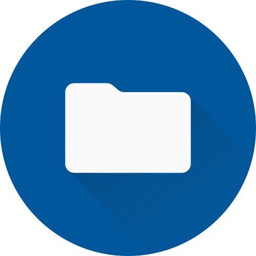
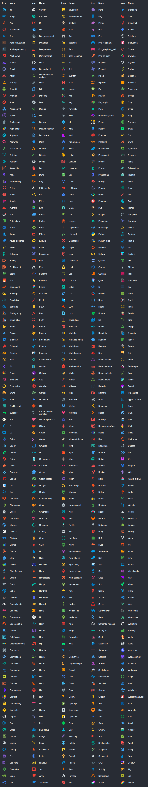
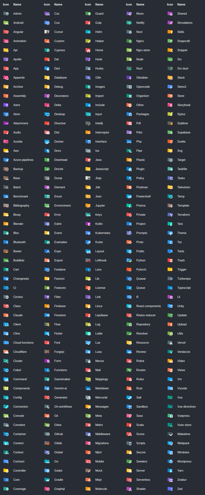
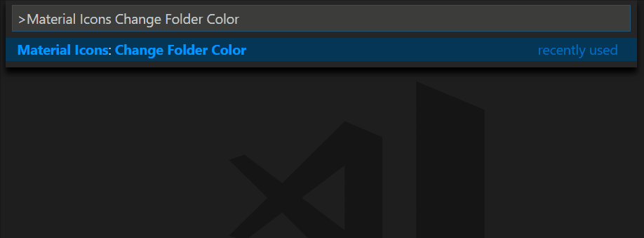
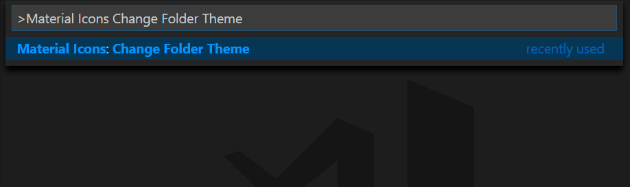
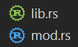
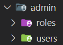
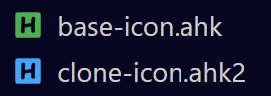
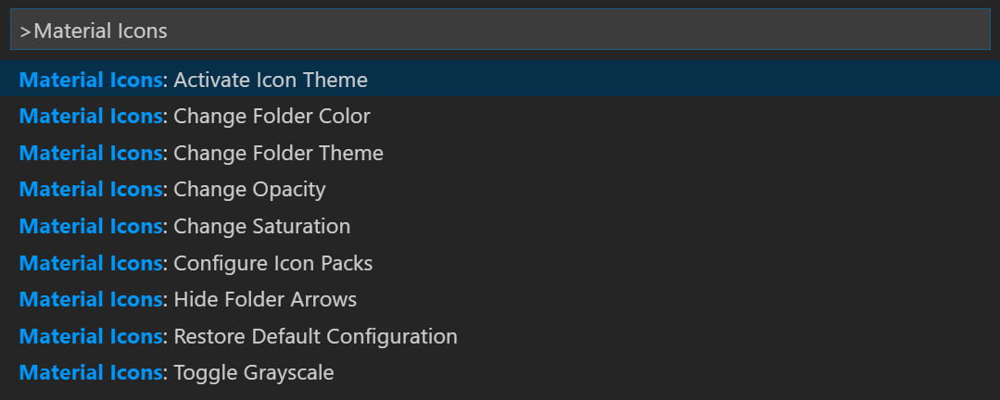

<p align="center">
  
</p>

<h1 align="center">Aurora Icon Theme</h1>

<p align="center"><em>适用于 Visual Studio Code 的 Material Design 图标</em></p>

<p align="center">
  <a href="https://github.com/aurorp1g/vscode-aurora-icon-theme"></a>
</p>

<br />


<p align="center">喜欢 Aurora Icon Theme？欢迎点星或成为赞助者来支持这个项目！</p>

<p align="center">
  <a href="https://github.com/sponsors/aurorp1g"></a>
  <a href="https://github.com/aurorp1g/vscode-aurora-icon-theme"></a>
</p>

<br />

### 文件图标

<details><summary>🏞️ <b>显示所有可用的文件图标</b></summary><br/></details>

### 文件夹图标

<details><summary>🏞️ <b>显示所有可用的文件夹图标</b></summary><br/></details>

<br />

## 目录

- [功能特性](#功能特性)
- [快速开始](#快速开始)
- [自定义](#自定义)
- [命令](#命令)
- [图标来源](#图标来源)
- [贡献者](#贡献者)
- [参与贡献](#参与贡献)
- [相关扩展](#相关扩展)

## 功能特性

- 为 VS Code 提供 Material Design 风格的文件与文件夹图标
- 可自定义颜色、不透明度与饱和度
- 支持图标包与主题
- 支持自定义图标关联与图标克隆
- 简单易用、风格现代，并持续维护

## 快速开始

1. **安装扩展**<br>
  从 [GitHub Releases](https://github.com/aurorp1g/vscode-aurora-icon-theme/releases) 页面下载最新的 `.vsix` 文件，然后在 VS Code 中使用 `Extensions: Install from VSIX...` 命令安装。

2. **启用图标主题**<br>
  打开命令面板（`Ctrl+Shift+P`，macOS 上为 `Cmd+Shift+P`），输入 `Aurora Icons: Activate Icon Theme` 并选择该项。

3. **享受新图标**<br>
  你的编辑器现在会为文件和文件夹显示美观、可自定义的 Material Design 图标。

## 自定义

你可以通过调整颜色、图标样式、不透明度等来个性化 Aurora Icon Theme 的外观，以匹配你的偏好或工作流程。

### 自定义文件与文件夹颜色

你可以通过命令面板修改默认文件和文件夹图标的颜色：



也可以通过用户设置修改：

```json
"aurora-icon-theme.folders.color": "#ef5350",
"aurora-icon-theme.files.color": "#42a5f5",
```

### 文件夹主题

你可以通过命令面板修改文件夹图标的设计：



也可以通过用户设置修改：

```json
"aurora-icon-theme.folders.theme": "specific"
```

### 自定义图标不透明度

你可以为图标设置自定义的不透明度：

```json
"aurora-icon-theme.opacity": 0.5
```

### 自定义图标饱和度

如果颜色不能让你满意，你可以降低图标的饱和度，让它们看起来偏灰；将饱和度设为 0 即可完全变成灰度：

```json
"aurora-icon-theme.saturation": 0.5
```

你也可以通过将 **Toggle Grayscale** 设为开启来实现无饱和度（即灰度）效果。

### 自定义图标关联

你可以直接在用户设置中自定义图标关联。

#### 文件关联

使用 `*.[extension]` 模式可以定义自定义的文件图标关联。例如，你可以为 `*.sample` 定义一个图标，那么所有以 `.sample` 结尾的文件都会使用该图标。不过，并非所有相同扩展名的文件都总是使用同一个图标——某些特定文件名会有专属图标。如果要把这些专属文件图标也一并覆盖，需要设置两个星号而不是一个，即 `**.[extension]`。

如果没有前置的 `*`，它将被自动配置为文件名，而不是文件扩展名。

```json
"aurora-icon-theme.files.associations": {
    "*.ts": "typescript",
    "**.json": "json",
    "fileName.ts": "angular"
}
```

#### 自定义 SVG 图标

你还可以通过提供 SVG 文件路径来添加自定义图标，该路径相对于扩展的 dist 文件夹。但有一项限制：自定义图标所在的目录必须位于用户目录下 `.vscode` 文件夹的 `extensions` 目录内。

例如，一个名为 `sample.svg` 的自定义 SVG 文件可以放在 VS Code `extensions` 文件夹下的 `icons` 文件夹中：

```text
.vscode
 ┗ extensions
   ┗ icons
     ┗ sample.svg
```

在 settings.json（仅限用户设置！）中，可以像这样把图标关联到文件名或文件扩展名：

```json
"aurora-icon-theme.files.associations": {
    "fileName.ts": "../../icons/sample"
}
```

_注意：自定义文件名在设置中配置时不能带 `.svg` 后缀，如上例所示。_

#### 自定义文件图标克隆

你还可以克隆现有的文件图标并修改其颜色，从而创建可关联到文件名或文件扩展名的新图标。下面的示例展示了如何克隆 `rust` 图标：

```json
"aurora-icon-theme.files.customClones": [
  {
    "name": "rust-mod",
    "base": "rust",
    "color": "blue-400",
    "fileNames": ["mod.rs"]
  },
  {
    "name": "rust-lib",
    "base": "rust",
    "color": "light-green-300",
    "lightColor": "light-green-600",
    "fileNames": ["lib.rs"]
  }
]
```

这会创建两个新图标 `rust-mod` 和 `rust-lib`，分别关联到文件名 `mod.rs` 和 `lib.rs`。`base` 属性定义要克隆的图标（此处为 `rust` 图标）。`color` 属性定义新图标的颜色。`lightColor` 属性是可选的，用于定义 Visual Studio Code 使用浅色主题时图标的颜色。`fileNames` 属性定义应关联到新图标的文件名。此外还有 `fileExtensions` 属性，可用于把新图标关联到文件扩展名（`"fileExtensions": ["ext", "ext2"]`）。



- 虽然 `color` 和 `lightColor` 属性可以使用任意 `#RRGGBB` 颜色，但如果你想沿用 Material 调色板中的颜色，可以在 [materialPalette.ts](https://github.com/aurorp1g/vscode-aurora-icon-theme/blob/main/src/core/generator/clones/utils/color/materialPalette.ts) 中查看允许使用的别名完整列表。
- 你可以在 [fileIcons.ts](https://github.com/aurorp1g/vscode-aurora-icon-theme/blob/main/src/core/icons/fileIcons.ts) 中查看可用作 `base` 的图标完整列表。

#### 文件夹关联

下面的配置可以自定义文件夹图标。它同样可以覆盖现有图标关联，并组合出不错的效果。例如，你可以把文件夹主题切换为 "classic"，然后只为你喜欢的文件夹名称定义图标。

```json
"aurora-icon-theme.folders.associations": {
    "customFolderName": "src",
    "sample": "dist"
}
```

#### 自定义 SVG 文件夹图标

与文件类似，你也可以为文件夹图标引用自己的 SVG 图标。这里需要注意的是要提供两个 SVG 文件：一个用于文件夹关闭状态，另一个用于打开状态。这两个文件——我们称它们为 "folder-sample.svg" 和 "folder-sample-open.svg"——必须放在相对于扩展 dist 文件夹的目录中。该目录必须位于 `.vscode/extensions` 文件夹内的某个位置。

在我们的示例中，把它们放在 `.vscode/extensions` 文件夹下的 `icons` 文件夹里：

```text
.vscode
 ┗ extensions
   ┗ icons
     ┣ folder-sample.svg
     ┗ folder-sample-open.svg
```

在 settings.json（仅限用户设置！）中，可以像这样把文件夹图标关联到文件夹名称（例如 "src"）：

```json
"aurora-icon-theme.folders.associations": {
    "src": "../../../../icons/folder-sample"
}
```

#### 自定义文件夹图标克隆

你还可以克隆现有的文件夹图标并修改其颜色，从而创建可关联到文件夹名称的新图标。下面的示例展示了如何克隆 `admin` 文件夹图标：

```json
"aurora-icon-theme.folders.customClones": [
  {
    "name": "users-admin",
    "base": "admin",
    "color": "light-green-500",
    "lightColor": "light-green-700",
    "folderNames": ["users"],
    "rootFolderNames": ["users"]
  },
  {
    "name": "roles-admin",
    "base": "admin",
    "color": "purple-400",
    "folderNames": ["roles"],
    "rootFolderNames": ["users"]
  }
]
```

这会创建两个新图标 `users-admin` 和 `roles-admin`，分别关联到文件夹名称 `users` 和 `roles`。`base` 属性定义要克隆的图标（此处为 `admin` 文件夹图标）。`color` 属性定义新图标的颜色。`lightColor` 属性是可选的，用于定义 Visual Studio Code 使用浅色主题时图标的颜色。`folderNames` 属性定义应关联到新图标的文件夹名称。`rootFolderNames` 属性定义应关联到新图标的根文件夹名称。



- 虽然 `color` 和 `lightColor` 属性可以使用任意 `#RRGGBB` 颜色，但如果你想沿用 Material 调色板中的颜色，可以在 [materialPalette.ts](https://github.com/aurorp1g/vscode-aurora-icon-theme/blob/main/src/core/generator/clones/utils/color/materialPalette.ts) 中查看允许使用的别名完整列表。
- 你可以在 [folderIcons.ts](https://github.com/aurorp1g/vscode-aurora-icon-theme/blob/main/src/core/icons/folderIcons.ts) 中查看可用作 `base` 的图标完整列表。

#### 根文件夹关联

你可以自定义工作区根文件夹的图标。如果你希望项目的主文件夹有一个独特的图标，这会很有帮助。

要把某个图标（例如 server 文件夹图标）分配给某个根文件夹（例如 `backend`），请使用以下配置：

```json
"aurora-icon-theme.rootFolders.associations": {
  "backend": "server"
}
```

#### 自定义根文件夹图标颜色

要修改根文件夹图标的颜色，请添加以下设置：

```json
"aurora-icon-theme.rootFolders.color": "#F4511E"
```

#### 语言关联

通过下面的配置可以自定义语言图标。它同样可以覆盖现有图标关联。

```json
"aurora-icon-theme.languages.associations": {
  "languageId": "iconName",
  "json": "json"
}
```

你可以在上方的总览中查看可用的图标名称。`languageId` 允许的取值列表请参见 VS Code 文档中的 "[已知语言标识符](https://code.visualstudio.com/docs/languages/identifiers#_known-language-identifiers)"。

#### 自定义语言图标克隆

你还可以克隆现有的语言图标并修改其颜色，从而创建可关联到语言 ID 的新图标。下面的示例展示了如何克隆 `autohotkey` 语言图标：

```json
"aurora-icon-theme.languages.customClones": [
  {
    "name": "ahk-clone",
    "base": "autohotkey",
    "color": "blue-400",
    "lightColor": "grey-600",
    "ids": ["ahk2"]
  }
]
```

这会创建一个新图标 `ahk-clone`，关联到语言 ID `ahk2`。`base` 属性定义要克隆的图标（此处为 `autohotkey` 语言图标）。`color` 属性定义新图标的颜色。`lightColor` 属性是可选的，用于定义 Visual Studio Code 使用浅色主题时图标的颜色。`ids` 属性定义应关联到新图标的语言 ID。



- 虽然 `color` 和 `lightColor` 属性可以使用任意 `#RRGGBB` 颜色，但如果你想沿用 Material 调色板中的颜色，可以在 [materialPalette.ts](https://github.com/aurorp1g/vscode-aurora-icon-theme/blob/main/src/core/generator/clones/utils/color/materialPalette.ts) 中查看允许使用的别名完整列表。
- 你可以在 [fileIcons.ts](https://github.com/aurorp1g/vscode-aurora-icon-theme/blob/main/src/core/icons/fileIcons.ts) 中查看可用作 `base` 的图标完整列表。

## 命令

按 `Ctrl-Shift-P` 打开命令面板，然后输入 `Aurora Icons`。



### 命令列表

| 命令                              | 描述                                                                         |
|------------------------------------|-------------------------------------------------------------------------------------|
| **Activate Icon Theme**            | 启用图标主题。                                                            |
| **Change File Color**              | 修改文件图标的颜色。                                                 |
| **Change Folder Color**            | 修改文件夹图标的颜色。                                               |
| **Change Folder Theme**            | 修改文件夹图标的设计。                                              |
| **Change Opacity**                 | 修改图标的不透明度。                                                 |
| **Change Root Folder Color**       | 修改根文件夹图标的颜色。                                          |
| **Change Saturation**              | 修改图标的饱和度值。                                           |
| **Configure Icon Packs**           | 选择可启用额外图标的图标包（例如用于 Angular、React、Ngrx）。 |
| **Restore Default Configuration**  | 恢复默认配置。                                                 |
| **Toggle Explorer Arrows**         | 显示或隐藏文件夹图标旁的箭头。                                   |
| **Toggle Grayscale**               | 将图标饱和度设为 `0`（灰度）或 `1`（彩色）。                             |

## 图标来源

- [Material Design Icons](https://pictogrammers.com/library/mdi/)
- [Material Symbols](https://fonts.google.com/icons)

## 贡献者

感谢我们所有出色的贡献者！
你们的支持让 Aurora Icon Theme 变得更好，惠及每一个人。

[](https://github.com/aurorp1g/vscode-aurora-icon-theme/graphs/contributors)

## 参与贡献

我们欢迎各种形式的贡献！无论你想添加新图标、改进文档、修复缺陷，还是协助翻译，我们都非常感谢你的投入。

**如何参与：**

- 📖 **阅读[贡献指南](https://github.com/aurorp1g/vscode-aurora-icon-theme/blob/main/CONTRIBUTING.md)**
  了解我们的编码规范、图标设计技巧与工作流程。

- 🐛 **报告问题**
  发现了缺陷，或者有图标需求？[提交 Issue](https://github.com/aurorp1g/vscode-aurora-icon-theme/issues)。

- 💡 **提交 Pull Request**
  准备好贡献代码或图标了？[创建 Pull Request](https://github.com/aurorp1g/vscode-aurora-icon-theme/pulls)。

- 🌍 **协助翻译**
  通过编辑 `src/core/i18n/translations/` 和 `package.nls.*.json` 中的文件来改进或新增翻译。

---

<p align="center">
  <a href="https://github.com/sponsors/aurorp1g"></a>
  <a href="https://github.com/aurorp1g/vscode-aurora-icon-theme"></a>
</p>
<p align="center">
  <em>喜欢 Aurora Icon Theme？欢迎点星或成为赞助者来支持这个项目！</em>
</p>

